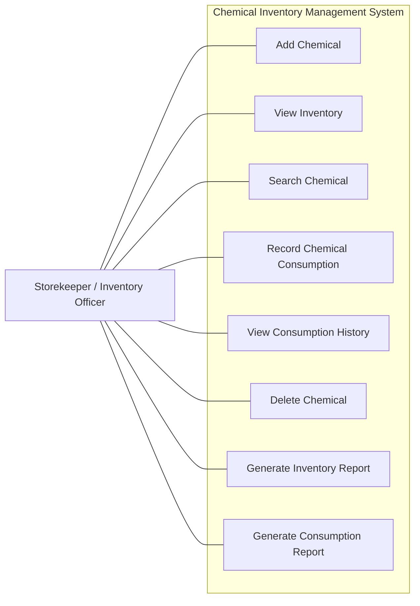

# 08. Use Case Diagram

## 1. Purpose

This diagram illustrates the interactions between the intended user and the Chemical Inventory Management System. It identifies the major functions available within the application.

## 2. Actors

**Storekeeper / Inventory Officer**

The primary business actor responsible for maintaining chemical inventory information, recording chemical transactions, and generating reports.

## 3. Use Case Diagram

## 4. Use Case Descriptions

| Use Case | Description |
|---|---|
| Add Chemical | Adds a new chemical to the inventory. |
| View Inventory | Displays the current chemical inventory. |
| Search Chemical | Retrieves a chemical using its name. |
| Record Chemical Consumption | Records consumption and updates available stock. |
| View Consumption History | Displays historical consumption transactions. |
| Delete Chemical | Removes a chemical from the current inventory. |
| Generate Inventory Report | Generates an Excel inventory report. |
| Generate Consumption Report | Generates an Excel consumption report. |

## 5. Notes and Assumptions

- The Storekeeper / Inventory Officer represents an intended business user.
- The diagram illustrates the current application's major user interactions.
- The current application does not implement authentication or role-based access control.
- The diagram uses a simplified system interaction view for portfolio documentation.
