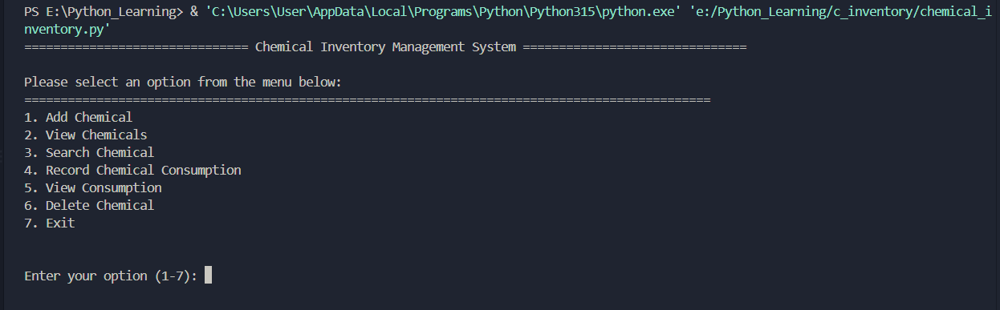
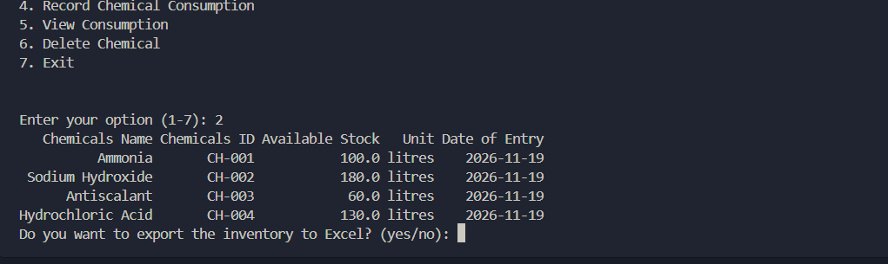
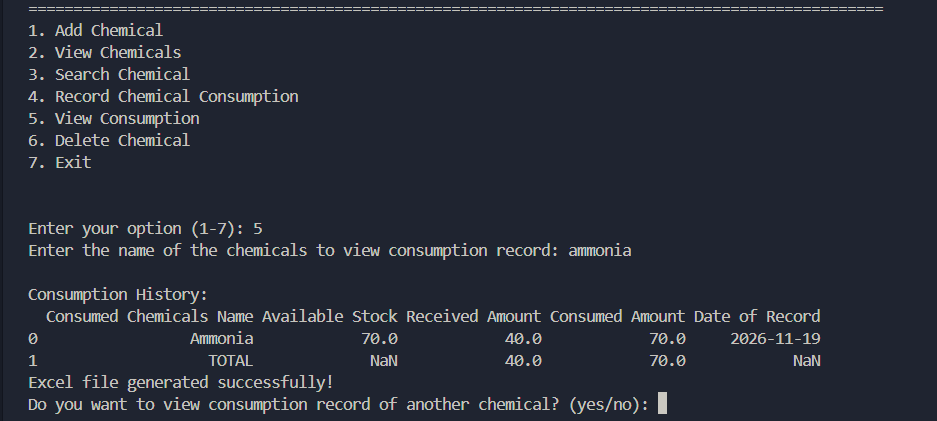

# Chemical Inventory Management System
### A Business Analysis and Python-Based Inventory Management Project

## 1. Project Overview

The Chemical Inventory Management System is a Python-based application designed to manage chemical inventory records, monitor stock movements, and generate inventory reports.

This project demonstrates the application of Business Analysis principles alongside Python programming to address a practical inventory management challenge.

## 2. Business Problem

Organisations that use chemicals in their operations need accurate records of chemical quantities, receipts, and consumption.

Manual inventory management can create challenges such as:

- Inaccurate stock records.
- Difficulty tracking chemical consumption.
- Errors in stock calculations.
- Time-consuming retrieval of inventory information.
- Difficulties preparing inventory reports.

## 3. Proposed Solution

This application provides a structured approach to chemical inventory management by allowing users to register chemicals, record stock movements, monitor available quantities, retrieve historical consumption records, and export reports.

## 4. Key Features

- Chemical registration and unique chemical ID generation.
- Opening stock entry and quantity validation.
- Chemical inventory viewing and searching.
- Recording received and consumed quantities.
- Automatic available stock calculation.
- Prevention of negative quantities and insufficient-stock transactions.
- Historical consumption tracking.
- Chemical record deletion while retaining historical transaction records.
- CSV-based data persistence.
- Excel inventory and consumption report generation.

## 5. Business Analysis Activities

The project incorporates the following Business Analysis activities:

1. Business problem identification.
2. Project objectives and scope definition.
3. Stakeholder identification and analysis.
4. Business requirements documentation.
5. Functional and non-functional requirements development.
6. Business process flow documentation.
7. Use case specification and diagram development.
8. Test case preparation and manual testing.
9. Gap analysis and future enhancement recommendations.

## 6. Tools and Technologies

| Technology      | Purpose |
|---|---|
| Python          | Application development |
| Pandas          | Data manipulation and management |
| CSV             | Persistent data storage |
| Microsoft Excel | Inventory and consumption reports |
| GitHub          | Source code and project documentation |

## 7. Project Structure

```text
Chemical-Inventory-Management-System/
│
├── README.md
│
├── Documentation/
│   ├── 01_Project_Overview.md
│   ├── 02_Stakeholder_Analysis.md
│   ├── 03_Business_Requirements.md
│   ├── 04_Functional_Requirements.md
│   ├── 05_Non_Functional_Requirements.md
│   ├── 06_Business_Process_Flow.md
│   ├── 07_Use_Case_Specification.md
│   ├── 08_Use_Case_Diagram.png
│   ├── 09_Test_Cases.xlsx
│   └── 10_Gap_Analysis.md
│
├── Source_Code/
│   └── chemical_inventory.py
│
└── Sample_Reports/
    ├── Sample_Inventory.xlsx
    └── Sample_Consumption.xlsx
```

## 8. Installation and Execution

### Prerequisites

Ensure that Python and Git are installed on your computer.

### Clone the Repository

Open a terminal or command prompt and execute:

```bash
git clone https://github.com/shahidul48/Chemical-Inventory-Management-System.git
```

### Navigate to the Project Directory

```bash
cd Chemical-Inventory-Management-System
```

### Install Required Dependencies

```bash
pip install -r requirements.txt
```

### Run the Application

```bash
python chemical_inventory.py
```

### Start Using the Application

After running the application, the main menu will appear. Select the required option to manage chemical inventory, record consumption, view reports, and perform other available operations.

**Note:** Python must be installed on your computer before executing the application.

## 9. Future Enhancements

Potential improvements include:

- Database integration using SQLite or PostgreSQL.
- Automatic low-stock alerts.
- Chemical batch and expiry date tracking.
- Supplier management.
- User authentication and access control.
- Power BI inventory dashboards.
- Advanced inventory analytics.

## 10. Project Outcomes

The project demonstrates how business requirements can be translated into functional software capabilities.

It combines operational problem-solving, requirements engineering, process documentation, software development, and testing in a practical inventory management scenario.

---

**Project Category:** Business Analysis / Inventory Management / Python Application

**Status:** Initial version completed; future enhancements identified.

## Application Screenshots

### 1. Main Menu


### 2. Chemical Inventory


### 3. Chemical Consumption History

